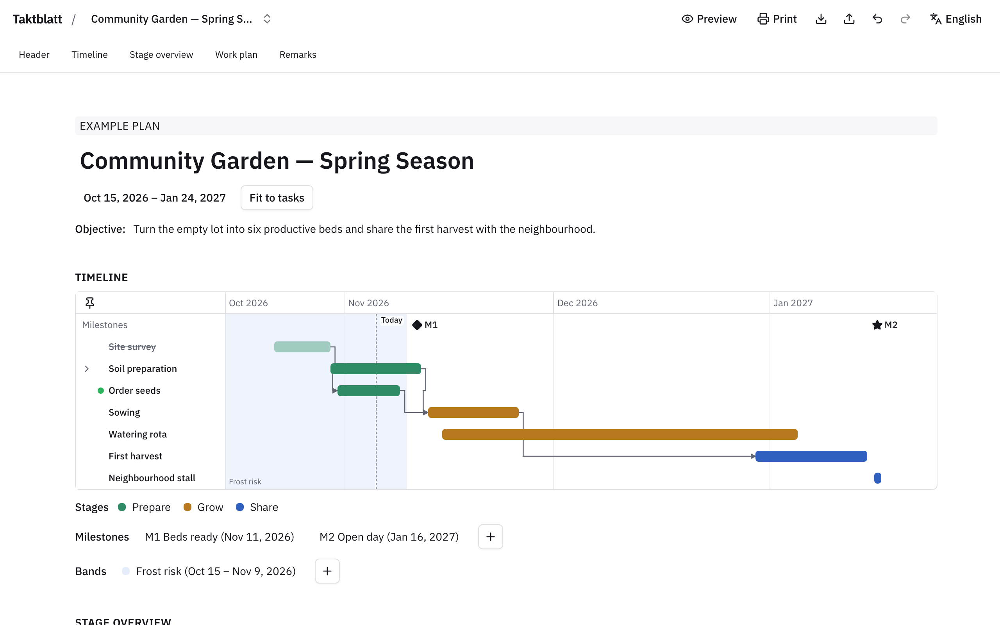
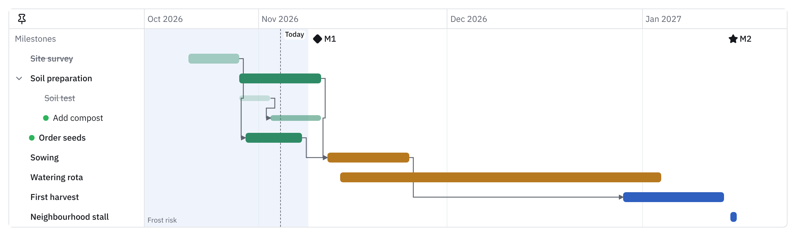
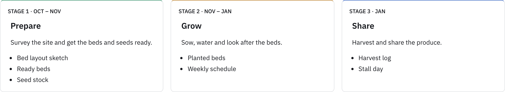
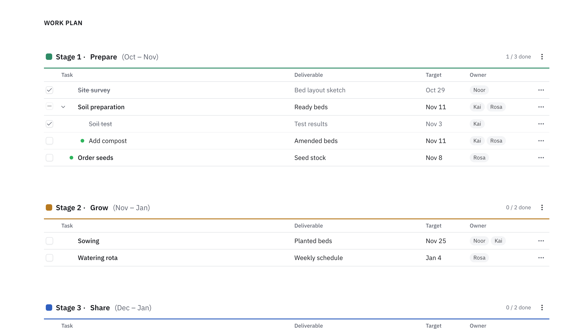
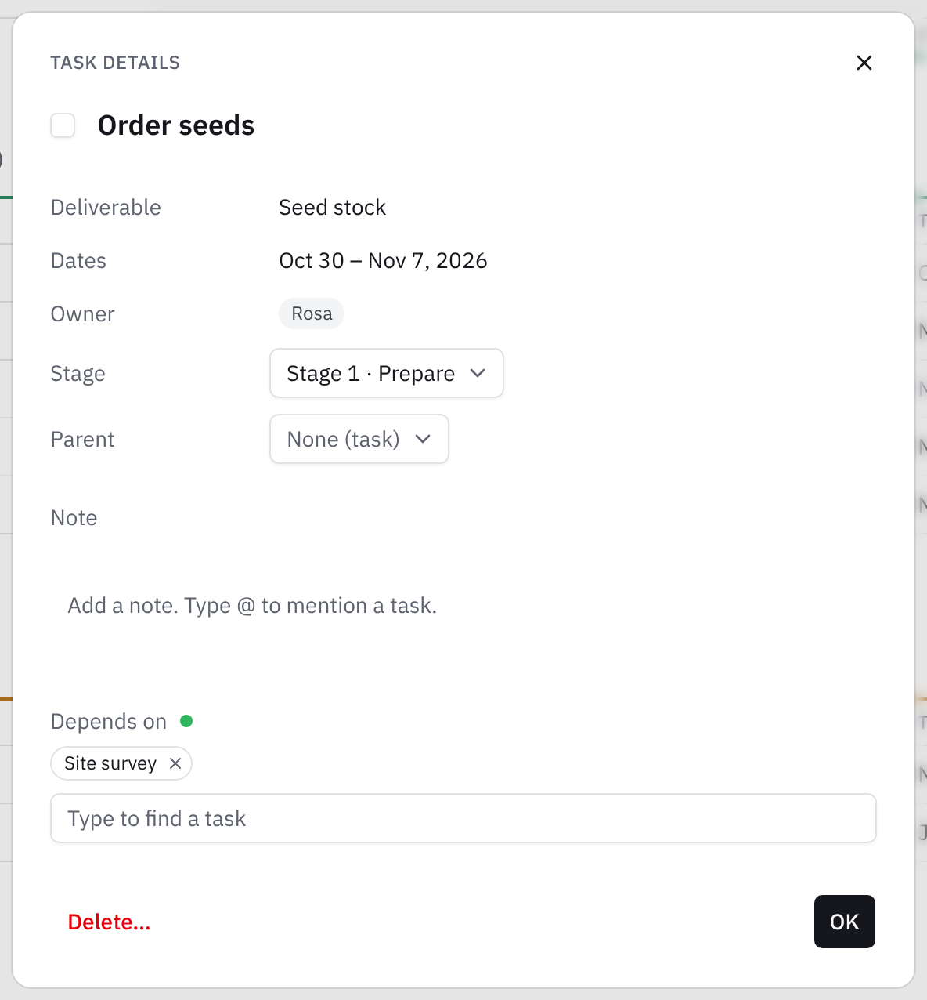
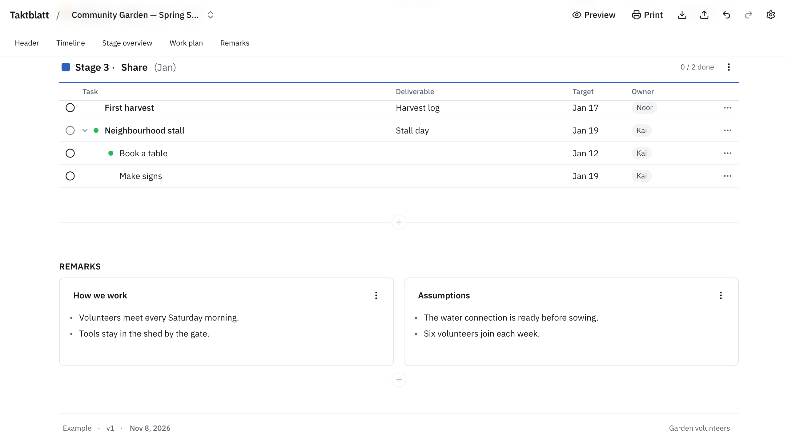
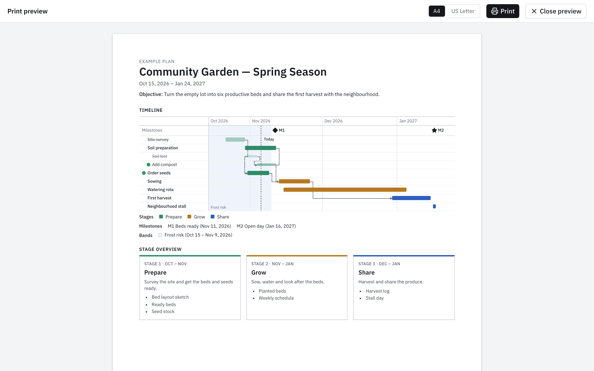
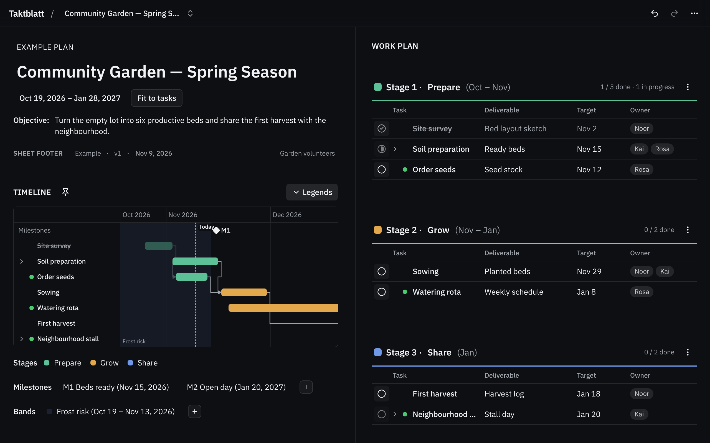

# Taktblatt

Taktblatt is a planner for the browser. You write a plan once. Taktblatt shows it as a Gantt timeline, a stage overview and a work plan table. You can print the plan on A4 or US Letter paper, or save it as a PDF. The app has no server and no account. Your data stays in your browser.



## Features

### Plan header and range

Each plan has a heading, a subheading and an objective. The plan range sets the dates that the Gantt shows. Click **Fit to tasks** to set the range to the dates of all tasks.

### Gantt timeline



- Each task has one bar. A parent task has a chevron. Click it to show the subtasks.
- Thin lines show the dependencies between tasks.
- Bands show a time range as a tint behind the bars, for example a time of frost risk.
- Milestones show as symbols on their own row. Each milestone has a label M1, M2 and so on.
- A dashed line shows today.
- Click a task label to go to its row in the work plan.
- Use the pin button to keep the whole Timeline section at the top of the page while you scroll. While pinned, drag its bottom edge or use the Taller and Shorter buttons to change its height. Use the Legends button to show or hide Stages, Milestones and Bands together.

### Stage overview



Each stage has a card. The card shows the months of the stage, a title, a description and the list of deliverables. Click the title or the description to edit it.

### Work plan table



- Tasks are in stages. Each stage has a color.
- A task can have subtasks. The parent shows the earliest start, the latest end, the owners and the progress of its subtasks.
- Each row has a status select (Todo, In progress, Done or Canceled), a deliverable, a target date and owner chips.
- A green dot, the ready light, shows that all dependencies of a task are done or canceled and the task is still Todo.
- Click a cell to edit it. Drag a stage to change the stage order.

### Task dialog



Click the "…" button of a row to open the task dialog ("Task details"). You can change the stage or the parent of the task, write a note and choose the dependencies. Type `@` in a note to mention a task. If a change causes a conflict, the app lists it before the change.

### Remarks and footer



Remark sections hold lists of short bullets at the end of the plan. The footer has a note, a version, a date and a text on the right side. The sheets show the same footer on each page.

### Preview and print



Click **Preview** to see the paper sheets. Choose A4 or US Letter. Click **Print** to print the plan or to save it as a PDF. The printed labels and dates use the UI language.

### Several plans, import, export and offline use

- Create, rename, duplicate and delete plans with the plan switcher in the app header.
- Export one plan or all plans as JSON files. Import them again on any device.
- Undo with Cmd/Ctrl+Z. Redo with Shift+Cmd/Ctrl+Z or Ctrl+Y.
- Install the app as a PWA. It works offline after the first visit.

### Languages

The app has four UI languages: English, German, Traditional Chinese and Japanese. Open **Settings → Language** to select one. The UI language also sets the date formats and the printed labels. A plan file has no language, so you can open the same file in any UI language.

### Privacy

- The app has no server and no account.
- The app keeps all data in your browser (`localStorage`).
- The app has no analytics and no telemetry. It sends no data on the network.

### Dark mode

Open **Settings** in the app header. Under **Theme**, choose **Light**, **Dark** or **System**. The default is **System**. The app saves your choice in this browser. Preview sheets and printed sheets are always light.



## Quick start

1. Open the app in a modern browser.
2. Click **Load example** to see a complete example plan. Or start with the empty plan.
3. Click a heading, a date or a task to edit it.
4. Click **Preview** to see the sheets.
5. Click **Print** to print the plan or to save it as a PDF.
6. Click **Export → Export this plan** to save a copy of your plan as a JSON file.

## Development

### Requirements

- Node.js 24 or later
- pnpm 11

### Install the dependencies

1. Run `pnpm install`.
2. Run `pnpm e2e:install`. This installs the Chromium browser for the tests.

### Start the development server

1. Run `pnpm dev`.
2. Open the URL that the terminal shows.

### Build the app

1. Run `pnpm build`.
2. Find the static files in the `build` folder.
3. To examine the build, run `pnpm preview`.

### Do the checks

| Command                | Check                                     |
| ---------------------- | ----------------------------------------- |
| `pnpm lint`            | Format (Prettier) and code rules (ESLint) |
| `pnpm check`           | Types (svelte-check)                      |
| `pnpm test:unit --run` | Unit tests                                |
| `pnpm test:e2e`        | End-to-end tests (Playwright)             |

### Format the code

- Run `pnpm format` to format the full repository.
- Run `pnpm format:src` to format JavaScript, TypeScript, Svelte and CSS files under `src/`.
- Run `pnpm format:watch` to format those files when you add or save them. Keep this command running in a separate terminal while you run `pnpm dev`. Press Ctrl+C to stop it.

The watcher excludes paths in `.gitignore`, including generated files in `src/lib/paraglide/`. Prettier also applies `.prettierignore` when it formats a file.

The shared configuration uses the official [Svelte Prettier plugin](https://github.com/sveltejs/prettier-plugin-svelte) and [Tailwind CSS Prettier plugin](https://github.com/tailwindlabs/prettier-plugin-tailwindcss). The Tailwind plugin loads last and uses `src/routes/layout.css` as the Tailwind v4 stylesheet. The watcher uses `onchange`, as shown in the [Prettier watch guide](https://prettier.io/docs/watching-files).

Run `pnpm install` to install the dependencies and activate the Husky Git hooks. Before each commit, the hook runs lint-staged to format supported staged files with Prettier. This includes source, configuration and documentation files. Prettier keeps its ignore rules and skips unknown file types.

The hook keeps unstaged edits out of the commit, including edits in partially staged files. A formatting error stops the commit. Correct the error, stage the correction and commit again. CI still runs `pnpm lint` to check formatting and code rules.

### Browser automation for coding agents

Use the [Playwright agent CLI](https://playwright.dev/agent-cli/introduction) for interactive browser checks. The installed Playwright dependency includes the CLI; no global package is needed.

1. Run `pnpm browser:setup` to initialize the workspace and install the official skill in `.agents/skills/playwright-cli/`.
2. Run `pnpm e2e:install` if Chromium is not installed yet.
3. Start the app with `pnpm dev`. In another terminal, run:

```sh
pnpm browser open http://localhost:5173
pnpm browser snapshot
pnpm browser screenshot
pnpm browser close
```

Use the URL reported by Vite if port 5173 is occupied. Read the snapshot for element references, then use commands such as `pnpm browser click <ref>` or `pnpm browser fill <ref> "text"`. Refresh the snapshot after page changes. Run `pnpm browser --help` for all commands, and add `--headed` to `open` to see the browser.

`pnpm browser` automatically loads `.playwright/cli.config.json`: headless Chromium, an isolated browser profile, English locale, and a 1280×900 viewport. Generated snapshots and screenshots are ignored in `.playwright-cli/`. After upgrading Playwright, rerun `pnpm browser:setup` to refresh the bundled skill. CLI sessions support exploration; `pnpm test:e2e` runs the regression suite used by CI.

### Project structure

| Folder                | Content                                                  |
| --------------------- | -------------------------------------------------------- |
| `src/lib/domain/`     | Pure logic: schema, derived values, dependencies, Gantt  |
| `src/lib/state/`      | The store, commands, undo history and viewer state       |
| `src/lib/components/` | Svelte components for the workspace and the print sheets |
| `src/service-worker/` | The service worker for offline use                       |
| `src/routes/`         | The app page and the layout                              |
| `messages/`           | UI texts for each language                               |
| `e2e/`                | End-to-end tests                                         |
| `docs/`               | Specification, data model, decisions and screenshots     |

### Languages

The message files are in `messages/`. English (`en.json`) is the source.

> **Note:** The German, Traditional Chinese and Japanese texts are machine drafts. A native speaker must review them.

## Documentation

- [Specification](docs/spec.md)
- [Data model and file format](docs/data-model.md)
- [Architecture decision records](docs/adr/README.md)
- [Glossary](GLOSSARY.md)

## License

MIT. Refer to [LICENSE](LICENSE).
