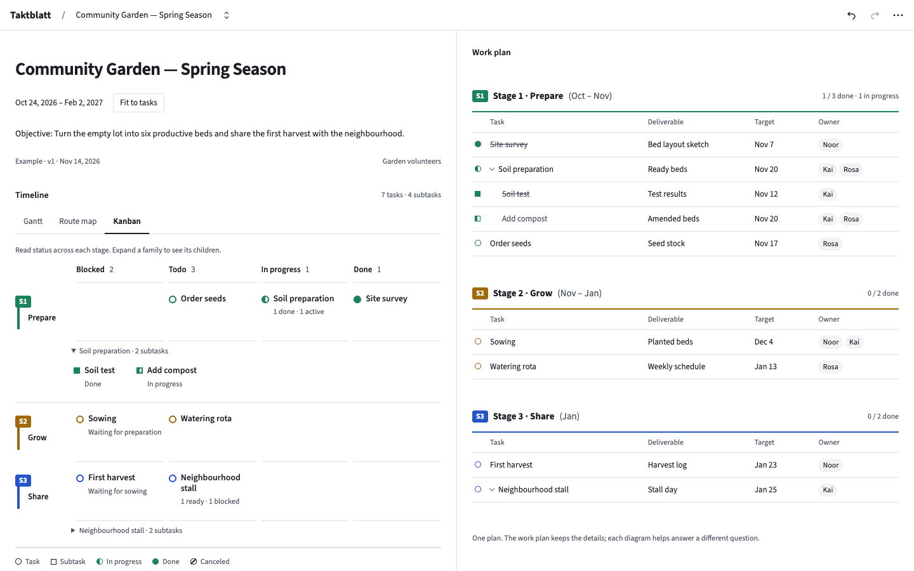
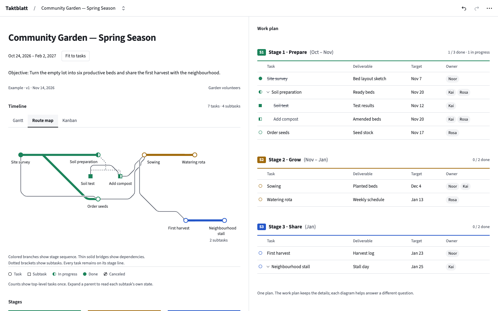
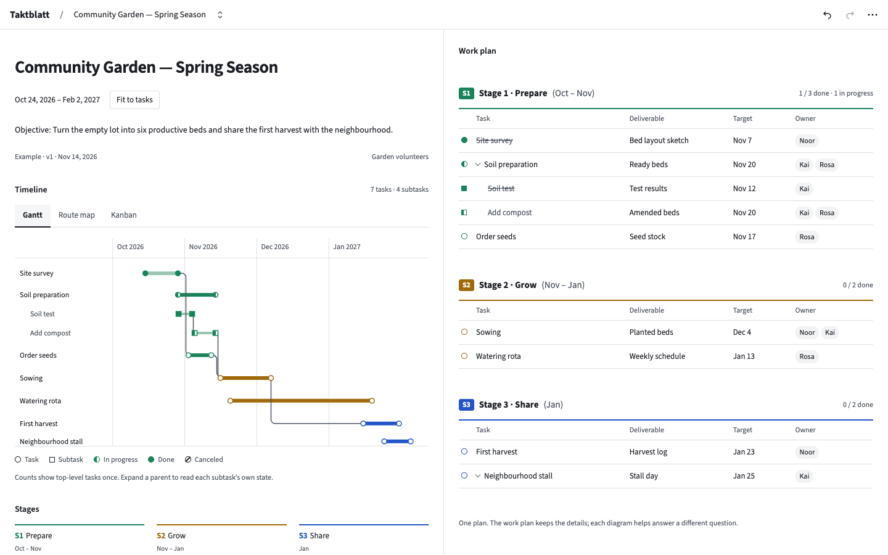

# Unified diagram design proposal

Status: Design proposal (2026-11-14). Do not implement the app in this PR.

This proposal records the selected design, its context and a future implementation plan.
The screenshots are static design studies. They do not show implemented app behavior.
The proposed lasting contract is [ADR 23](../adr/0023-unified-diagram-language.md).

## Problem and evidence

[PR #54](https://github.com/TimJJTing/Taktblatt/pull/54) adds Kanban. [PR #55](https://github.com/TimJJTing/Taktblatt/pull/55) adds Route map.
Both need to use the current app's visual language.

- Route map uses status-neutral stations and separate status icons. This conflicts with the shared status-fill rule.
- The same colored rail can follow a dependency or a synthetic sequence link. The new design must make their meanings clear.
- Kanban uses fixed `11rem` cards and `16rem` minimum columns. Normal split panes hide much of the board. Paper uses fixed 34 mm cards.
- Kanban shows leaves and ignores shared expansion. A parent selection can dim every visible card. This conflicts with a parent-first overview.
- Shared motion captures station geometry but moves whole task boxes. Cross-container flights are deferred. Hooks do not prove station continuity.
- Existing records mix lasting design rules with branch ownership, locale insertion and merge instructions. These delivery rules must not govern visual design.

## Selected design

| Surface   | Primary question                             | Selected treatment                               |
| --------- | -------------------------------------------- | ------------------------------------------------ |
| Gantt     | When does work happen?                       | Compact duration lines and station signs         |
| Route map | What follows what, and what depends on what? | Compact signs and labels with PR #55's branching |
| Kanban    | What needs attention?                        | Four status columns across stage swimlanes       |
| Work plan | What are the complete task details?          | The compact table from the selected study        |

Keep the white ground, Source Sans 3, quiet controls and established stage palette.
Task circles and subtask squares keep their status fill across all views and paper.
Use 45° and 90° routes with small bounded curves at bends.

The primary reference is the [Berlin S-Bahn map](https://upload.wikimedia.org/wikipedia/commons/d/d7/S-Bahn_Berlin_-_Netzplan.svg).
The [London transport map](https://upload.wikimedia.org/wikipedia/commons/1/13/London_Underground_Overground_DLR_Crossrail_map.svg) also informed the distinct subtask signs.

Kanban starts with parent summaries and child-state counts. Expansion shows a family detail strip.
The stage badge and a connected vertical stem form a “p” shape. Put the stage name to the right of the stem, with clear space for wrapped text.

Colored branches show stage workflow. Separate neutral paths show real dependencies.
Collapsed parents summarize both incoming and outgoing hidden-subtask dependencies. Expansion restores exact endpoints.
Keep stored provenance and omit synthetic sequence links from dependency calculations.

Print detail is separate from screen expansion. The printed Work plan remains complete.
Station-based motion must preserve identity during interrupted switches, scrolling and reduced motion.

## Design studies

These desktop studies use the example plan. The Work plan is visible beside each diagram.
They record composition and notation. They do not establish responsive or printed geometry.

## Future integration plan

Astra reviewed the local branches after the design selection. It recommended one integration branch and one shared implementation of notation, family summaries and motion.
At review time, both feature branches started at `69e36ee`; `main` was `690a7a8`. Their production-file changes were disjoint. Documentation and locale catalogs overlap. No trial merge was performed.
[PR #57](https://github.com/TimJJTing/Taktblatt/pull/57) contains a shared-motion placeholder, not another motion implementation.

1. Create `feat/unified-diagrams` from the agreed current `main`. Preserve the histories and local artifacts of PRs #54 and #55.
2. Update the shared specification and affected ADRs. Resolve conflicting rules centrally. Have a separate agent verify the plan before code changes.
3. Write failing behavior tests for shared signs, family counts, dependency projection and independent print detail. Implement the shared foundation once.
4. Adapt Kanban to stage swimlanes. Adapt Route map while retaining its branching and bend machinery. Keep these changes in separate reviewable commits.
5. Complete shared station motion and focus handling. Test real view pairs, including scroll and interrupted transitions.
6. Validate the combined branch. Mark existing feature PRs as superseded only after their work is safely represented. Merge only after required CI passes.

Keep delivery ownership and merge instructions in this proposal or the implementation PRs.
Do not use them as permanent exceptions to the shared visual contract.

## Acceptance scenes for implementation

- The example plan has seven eligible top-level summaries. Expanding either parent does not change column counts. Mixed ready and blocked children remain visible in the summary.
- A fork and join retain PR #55's branching. Tasks without dependencies stay on workflow rails. Synthetic links never change readiness, cycles or dependency focus.
- Collapsed families project stored dependencies in both directions. Expanded families show exact endpoints. Aggregated paths keep provenance and do not create internal self-links.
- All task and subtask status signs agree across diagrams, Work plan, Preview and paper. Check dark mode, forced colors and grayscale output.
- Long stage names wrap without touching the connected stem. Long task names, empty stages, dense plans and narrow panes remain readable.
- Every view pair supports interrupted and scrolled switching. Verify station continuity, focus, label-only tasks, hidden children, cleanup and immediate reduced-motion changes.
- Independent diagram detail works on A4 and Letter. It does not change screen expansion, hide printed Work plan children or mutate exported plans.
- Offline reload preserves viewer choices. Check offline edits and Preview. Validate an installed PWA when available and report any unavailable mode.

## Limits and remaining policy details

This PR changes documentation and design evidence only. It does not merge the feature branches, change the plan schema, add Kanban drag or add zoom.
Zoom is optional future work. Compact layout and explicit expansion are sufficient for this proposal.

Before implementation, state the print-detail control scope and missing-target focus fallback in the specification.
One detail choice for selected diagrams is a proposed default, not a confirmed user choice.
Showing canceled children within an expanded active family is also a proposed default. Keep existing `boardColumn()` behavior for canceled top-level tasks.

Static desktop review does not validate production motion, responsive layouts, the app Preview, PDF pagination, an installed PWA or offline use.
Run changed-file formatting and `pnpm lint` for this documentation PR. No behavior tests are required until implementation starts.
