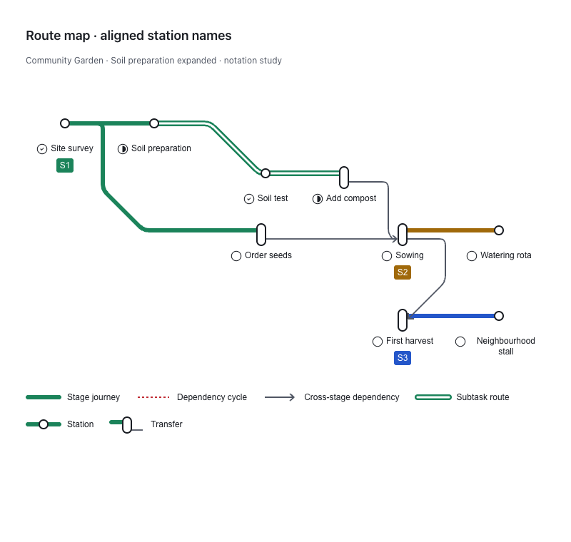
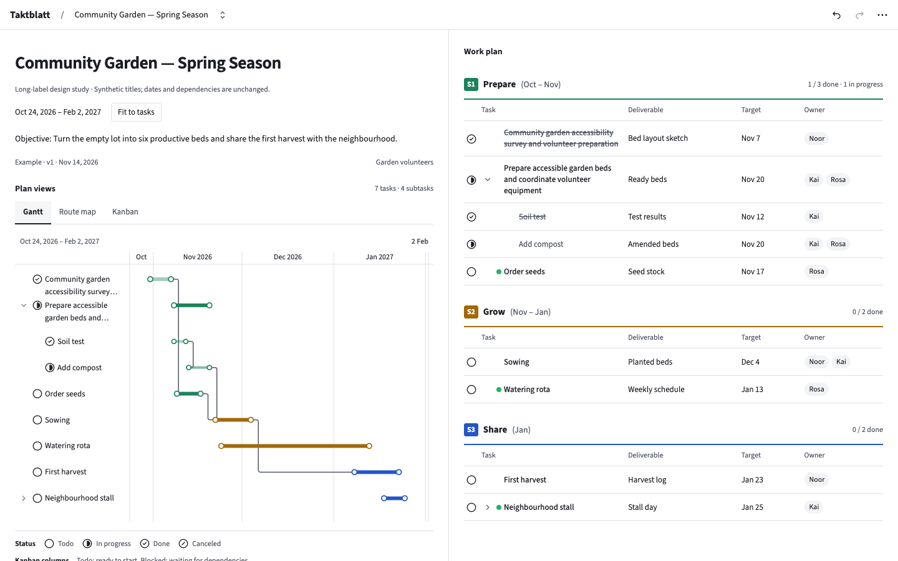
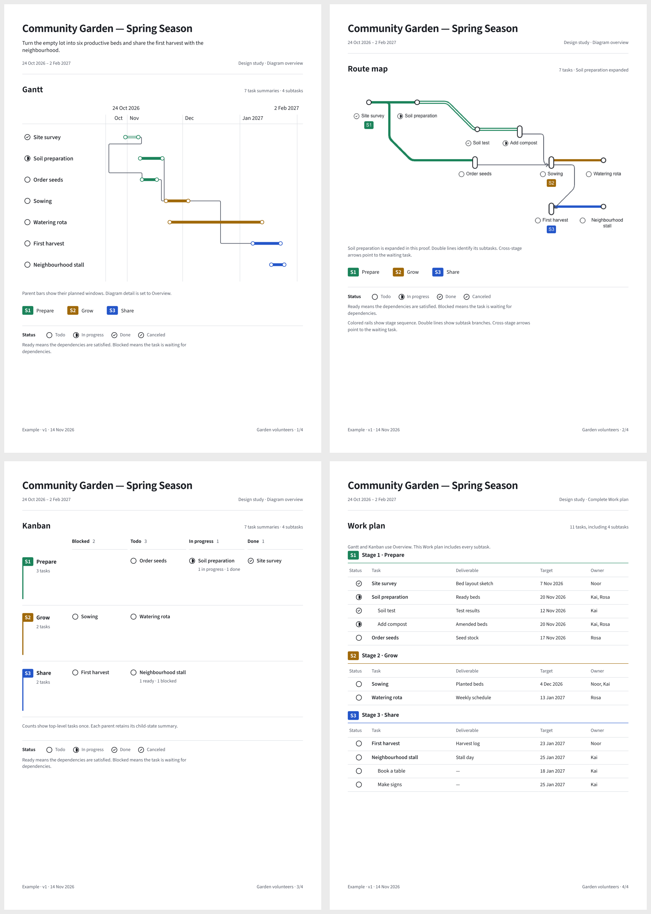

# Unified diagram design proposal

Status: Design proposal (2026-11-14). Do not implement the app in this PR.

Updated: 2026-11-16.

This proposal records the selected design and the future integration plan.
The screenshots are static studies. They do not show implemented app behavior.
The proposed lasting contract is [ADR 23](../adr/0023-unified-diagram-language.md).

## Problem and evidence

[PR #54](https://github.com/TimJJTing/Taktblatt/pull/54) adds Kanban. [PR #55](https://github.com/TimJJTing/Taktblatt/pull/55) adds Route map.
The views need consistent status meanings, family information and motion. Their compositions can differ to answer different questions.

- Route map must make workflow clear before family structure and status. PR #55's branches and transfer capsules establish that language. Its ordinary same-stage dependencies already use colored rails; thin exceptional links do not mean that every dependency has a duplicate overlay.
- The earlier unified study made task status too prominent in Route map. Square subtask signs also misread the requested transport-map reference. The selected design retains rounded status icons and gives Route map its own family notation.
- Kanban uses fixed `11rem` cards and `16rem` minimum columns. Normal split panes hide much of the board. Paper uses fixed 34 mm cards.
- Kanban shows leaves and ignores shared expansion. A parent selection can dim every visible card. The selected design uses parent summaries.
- Shared motion captures station geometry but moves whole task boxes. Cross-container flights are deferred. Hooks do not prove station continuity.

## Selected design

| Surface   | Primary question                    | Selected treatment                               |
| --------- | ----------------------------------- | ------------------------------------------------ |
| Gantt     | When does work happen?              | Compact duration lines and existing status signs |
| Route map | What follows what?                  | Continuous routes and attached subtask branches  |
| Kanban    | What needs attention?               | Four status columns across stage swimlanes       |
| Work plan | What are the complete task details? | Existing table and inline subtask expansion      |

Keep the white ground, Source Sans 3, quiet controls and established stage palette.
Dark screens use the matching dark surface. Printed sheets remain light.
Keep the app's rounded status icons for both tasks and subtasks: circle, half-filled circle, checked circle and slashed circle.
Use the same rounded notation for tasks and subtasks in every view, including Gantt and Work plan.
Do not introduce square subtask or status signs in diagrams, Work plan, Preview or paper.
Use the existing `TaskStatusIcon`: a 16 px viewport at 100% zoom, with the original Lucide geometry and stroke weight (`viewBox="0 0 24 24"`, stroke width 2).
Tasks and subtasks use the same icon size. Do not shrink status icons in dense layouts or keys. Preserve a comparable physical size on paper.

### Route map

The information order is workflow, parent–subtask structure, then task status.
Retain PR #55's branches, transfer capsules, horizontal segments, 45° and 90° turns, and small curves at bends.
Bound curves by segment length, station clearance and neighboring routes.

**Main routes.** Use continuous solid rails in the stage color. Retain tasks without explicit dependencies on the suggested stage journey.
Read stations from top to bottom and left to right. Do not draw chevrons on colored main or subtask routes.
Do not use dashed rails for suggested order. Required and suggested same-stage order deliberately share the same rail treatment.
A colored rail alone does not prove a stored dependency.

**Subtask routes.** Expansion keeps the parent station on its main line. Draw a connected branch from that station with two parallel lines in the same stage color.
The gap uses the actual diagram background: the matching surface in dark theme and the paper surface in print.
Use the same round stations and transfer capsules for tasks and subtasks. Do not use ticks, square stations or detached family brackets.
The branch attachment identifies membership. It does not create a dependency from the parent to the first child.
Real child sequencing determines the child route; suggested order does not change dependency calculations.

**Stations and names.** Keep stations status-neutral, without a second circle inside the station.
Center the name and its rounded status icon directly below the station. Use one consistent placement rule.
Use PR #55's colored stage badge below the name at the first station of each stage route only.
In the example, these stations are Site survey (S1), Sowing (S2) and First harvest (S3).
Do not repeat the badge at other tasks or subtasks. Do not add readiness dots or halos.

**Spacing.** Keep parent and child stations close. Compact the whole network, including connections between stages.
Reserve the full name, status icon and any badge before routing links.
Move stations or routing corridors when labels need space. Do not solve collisions by putting names arbitrarily above, below or far from their stations.

**Dependencies.** Draw ordinary cross-stage dependencies as thin neutral paths with small open destination chevrons. The cue points to the waiting task.
Do not add ordinary thin same-stage or sibling overlays. Preserve stored dependencies for readiness, cycle detection and route focus.
Cyclic dependencies are the exception: retain red dashed warning paths, including cycles within one stage.

Determine ordinary cross-stage eligibility from stored source and target stage ids before mapping hidden tasks to visible parents.
Collapsed parents summarize both incoming and outgoing eligible hidden-child dependencies. Expansion restores exact endpoints.
Keep edge provenance, aggregate equal visible endpoint pairs and omit internal self-links.
Synthetic sequence links never enter readiness, cycle or dependency-focus calculations. This Route map rule does not change Gantt dependency visibility.

### Kanban, family information and other views

Use stage swimlanes for Kanban. Each stage starts with a badge, a clear name and a top-level task count.
The badge and its connected vertical stem form a “p” shape. Align their left edges exactly.
Put the name to the right of the stem. Reserve space for wrapped names and align status columns across stages.

Show each eligible top-level task or parent summary once, using the existing `boardColumn()` and effective parent state.
Expansion reveals family detail without moving the summary or increasing top-level column counts.
Use the same outlined chevron button as Work plan for Kanban family expansion and collapse. Do not show a browser-native disclosure triangle.
Keep the compact Gantt composition, with the original rounded status icons.
Keep the existing parent expansion chevron from `GanttRow.svelte`: a separate button with an outlined chevron that points right when collapsed and down when expanded.
Keep the leaf spacer and shared expansion state with Work plan and Kanban.
Keep the existing row alignment and child indentation. Align the single-line Gantt label and its controls with the task line.
Gantt labels do not show family child-state counts below parent names.

Keep the same child-state breakdown across Route map and Kanban summaries. Adapt its placement to the diagram.
Ready and blocked counts are separate parts of Todo. Do not count a child twice.
Derive counts from the shared task index. Do not store them or introduce another parent-status calculation.
The approved Route map image establishes notation and label placement; it does not demonstrate the complete family-summary interaction.

Keep Work plan's existing design, as defined by `TaskRow.svelte` and `StageSection.svelte`.
Keep the separate chevron button for each parent. Expand children as indented table rows directly below the parent, with all columns aligned.
Preserve shared expansion state, keyboard navigation and focus behavior, readiness indicators, and table controls.
Do not replace the rows with a `details`/`summary` treatment or add family summaries below parent names.
Shared counts do not add family-summary lines to Gantt or Work plan. The Route map rule against readiness dots applies to Route map only.

Name Todo explicitly in status keys. Explain readiness separately. Use “In progress” consistently.
Keep “Plan views” as the section heading. Tie Gantt positions and Work plan dates to the same ISO-date fixture.

### Detail, motion and output

Print detail is independent of screen expansion. Keep the printed Work plan complete.
Use separate inputs for diagram detail and printed Work plan content.

Use the visible station as the identity anchor during view changes. Use the label when no station is visible.
One shared coordinator must handle interrupted transitions, scrolling and focus by task id.
Fade incompatible connectors without creating false intermediate dependencies. Decorative flight copies cannot take focus or input.
Use `motionDuration()` for all durations. Reduced motion changes views immediately. Preview and paper have no view-change animation.

## Design evidence

### Current Route map study

The approved 800 × 760 capture is a map-only desktop study of the example plan with Soil preparation expanded.
It shows connected double-line child routes, round stations, transfer capsules, aligned names and badges at stage-route starts.
The example contains no dependency cycle. The red dashed warning appears in the key only.

This capture does not validate the workspace shell, expansion controls, family summaries, mobile layout, dark theme, print or production routing.
It is the current Route map reference. The written rules define behavior beyond this scene.

### Composition and output studies

The following studies use the example fixture dated 2026-11-14. They show composition, counts and date positions.
The refreshed screenshots and PDFs use the original rounded status icons for tasks and subtasks, including Gantt and Work plan.
Status icons retain the size, geometry and stroke weight of the existing app icons.
The Work plan studies retain separate parent chevrons and aligned, indented child rows without added family summaries.
They remain static studies, not production validation.

The synthetic dense plan has 15 top-level tasks and eight subtasks in four stages. Its counts are six Blocked, five Todo, three In progress and one Done.
Desktop studies retain the stage matrix and split workspace. Phone studies stack status groups within each stage.
They test content reflow, not the production pinned mobile shell. Implementation must preserve the established diagram and workspace tab behavior.

The long-label screenshot uses Gantt with the example's dates and relations. It shows bounded Gantt labels and complete titles in Work plan.
The study's Route map tab embeds the approved regular-label desktop fixture. It does not test long-label route layout.

The [A4 study](unified-diagrams-a4-study.pdf) and [Letter study](unified-diagrams-letter-study.pdf) each have four pages.
They show diagram overviews followed by all 11 Work plan rows, including Book a table and Make signs.
They embed the approved Route map fixture and use rounded status icons throughout.
They support the separate-detail and complete-Work-plan composition. Embedding the fixture does not validate production route layout, app Preview or physical print output.

Seven companion screenshots and both PDFs were refreshed. The approved Route map fixture is unchanged.
All studies use the existing rounded status icons. Screen icons use a 16 px viewport. Paper icons retain a comparable physical size.
The static study's Kanban and Work plan controls share expansion state. The example shows zero child rows when collapsed and two when expanded.
Both PDFs have four pages. All 11 fixture task names appear in the Work plan on page 4, which fits the A4 and Letter sheets.
The approved Route map fixture is embedded on page 2.
The approved route fixture does not establish dark-theme rendering, dense or narrow route layout, long-label routing, actual cycle routing, app Preview, production pagination, PWA or offline behavior.

## Future integration plan

The previous branch review recommended one integration branch and one shared implementation of status meanings, family counts and motion.
At that review, both feature branches started at `69e36ee`; `main` was `690a7a8`. Production-file changes were disjoint; documentation and locale catalogs overlapped. No trial merge was performed.
[PR #57](https://github.com/TimJJTing/Taktblatt/pull/57) contained a shared-motion placeholder, not a motion implementation.

1. Create `feat/unified-diagrams` from the agreed current `main`. Preserve the histories and local artifacts of PRs #54 and #55.
2. Update the shared specification and affected ADRs before behavior changes. Explicitly reconcile earlier shared status-fill rules with Route map's separate status icons. Have a separate agent verify the plan.
3. Write failing behavior tests for status meanings, family counts, dependency projection and independent print detail. Implement the shared foundation once.
4. Adapt Kanban to stage swimlanes. Adapt Route map while retaining PR #55's branching and bend machinery. Use separate reviewable commits.
5. Complete station-based motion and focus handling. Test real view pairs, including scroll and interrupted transitions.
6. Validate the combined branch. Keep existing feature PRs available until their work is represented and the combined implementation passes required CI.

Keep temporary delivery and merge instructions here or in implementation PRs, not in the lasting visual contract.

## Acceptance scenes for implementation

- The example has seven eligible top-level summaries. Expanding a parent does not change Kanban column counts. Ready and blocked children remain separate in the family summary.
- A fork and join retain PR #55's geometry. Main routes stay solid, including suggested sequence links. No ordinary colored rail has a chevron. Stations read from top to bottom and left to right.
- Expanding Soil preparation keeps its station and adds a connected double-line branch through Soil test and Add compost. It uses the same stage color, round stations or transfer capsules, and no ticks or squares.
- Child-route gaps use the actual background in light theme, dark theme, forced colors and print. No white seam appears on a dark surface.
- Every name and rounded status icon sits directly below its station. Only Site survey, Sowing and First harvest carry stage badges in this example. Check long names without moving labels to arbitrary sides.
- Compact family spacing and cross-stage routing. Reserved label bounds remain clear of paths, stations and neighboring labels.
- There is no ordinary thin overlay for Site survey → Order seeds or Soil test → Add compost. Directed neutral paths remain from Add compost and Order seeds to Sowing, and from Sowing to First harvest.
- A cycle within one stage and a cycle across stages retain red dashed warning paths. Do not hide cycles under the ordinary same-stage overlay rule. The approved screenshot does not cover this test.
- Same-stage required and suggested edges share a visual treatment but keep distinct provenance. Synthetic links do not change readiness, cycles or dependency focus. The map adds no readiness dots or halos.
- Collapsed families project eligible hidden-child dependencies in both directions. Expansion restores exact endpoints. Aggregated paths keep provenance and do not create internal self-links.
- Tasks and subtasks use the same original rounded notation and status meanings in Gantt, Route map, Kanban, Work plan, Preview and paper. No view introduces square subtask or status signs.
- At 100% zoom, task and subtask status icons use the existing `TaskStatusIcon`: 16 px viewport, original Lucide geometry and stroke weight. Dense layouts and keys do not shrink them. Paper retains a comparable physical size. Route map station and rail geometry stays unchanged.
- Work plan retains the current parent chevron button and inline indented child rows, with aligned columns. Preserve shared expansion, keyboard navigation, focus, readiness indicators and table controls. Do not add a `details`/`summary` treatment or under-parent family summaries.
- Kanban names clear the connected stem. The badge and stem share a left edge. Family expansion uses Work plan's outlined chevron button, without a native disclosure triangle. Keep stage swimlanes, parent summaries and counts. Empty stages, long names and narrow panes remain readable.
- Gantt and Work plan use the same ISO dates. Site survey ends on Nov 7, after the November boundary. Show the exact plan range.
- Gantt parent labels keep the existing expansion chevron beside the status icon and task name, without family-summary lines. Expanding or collapsing a parent updates its child rows and the shared state in Work plan and Kanban.
- Every view pair supports interrupted and scrolled switching. Verify station continuity, focus, label-only tasks, hidden children, cleanup and immediate reduced-motion changes.
- Independent diagram detail works on A4 and Letter. It does not change screen expansion, hide printed Work plan children or mutate exported plans.
- Offline reload preserves viewer choices. Check offline edits and Preview. Validate an installed PWA when available and report any unavailable mode.

## Limits and open decisions

This PR changes documentation and design evidence only. It does not change app behavior, the plan schema or stored dependencies.
It does not merge feature branches, add Kanban drag or add zoom. Zoom remains optional future work.

Before implementation, define the print-detail control scope and missing-target focus fallback in the specification.
One detail choice for selected diagrams is a proposed default, not a confirmed user choice.
Showing canceled children within an expanded active family is also a proposed default. Keep existing `boardColumn()` behavior for canceled top-level tasks.

The final Route map needs production validation in the workspace, Preview, printed sheets and installed PWA, including offline use.
The current image does not validate dark-theme contrast, forced colors, actual cycles, long-label routing, motion, paper pagination or physical output.
Run changed-file formatting and `pnpm lint` for this documentation PR. App behavior tests start with implementation.
